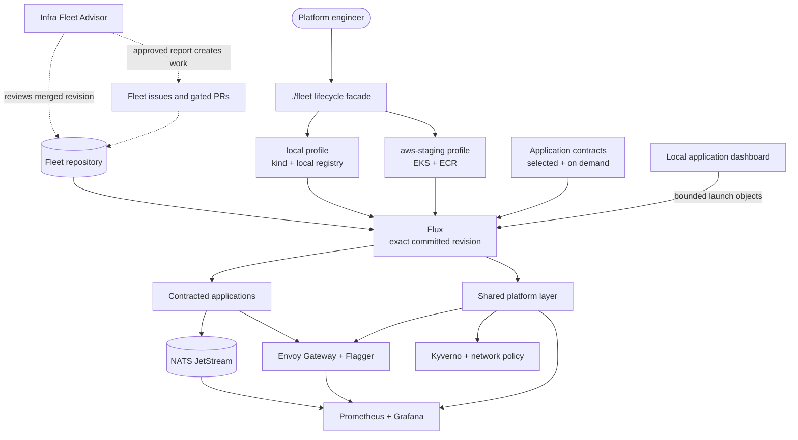

# Infra Fleet

Infra Fleet is a reusable Kubernetes platform template with one operating
interface for local kind and AWS EKS staging environments. Applications plug
into a small contract; the platform supplies GitOps reconciliation, routing,
progressive delivery, policy enforcement, messaging, and observability.

[Use this template](https://github.com/ImranAdan/infra-fleet-public/generate) ·
[Documentation](docs/README.md) · [Configuration](CONFIGURATION.md) ·
[Contributing](CONTRIBUTING.md) · [Security](SECURITY.md)

> [!IMPORTANT]
> The local profile is exercised end to end. The AWS profile is a staging
> preview and has not completed a full account apply, certificate issuance,
> canary, and teardown cycle. Treat it as an inspectable starting point until
> that acceptance run is complete.

## Start locally

The local profile requires Docker, Git, curl, and OpenSSL on Linux or macOS
(`amd64` or `arm64`). Allocate at least 8 GiB of memory to Docker. Setup installs
the pinned kind, kubectl, and Flux CLIs into checkout-owned state; it does not
change system packages.

```bash
git clone https://github.com/ImranAdan/infra-fleet-public.git
cd infra-fleet-public

./fleet setup --profile local
./fleet up --profile local
./fleet access --profile local --service dashboard
```

Open <http://localhost:9000/>. The dashboard shows the selected application and
can launch the other included applications from the same committed revision.
Each launched application is isolated behind its own platform controls and
returns to sleep after its idle window.

Use another terminal for direct service access:

```bash
./fleet access --profile local --service app         # http://localhost:8080
./fleet access --profile local --service prometheus  # http://localhost:9090
./fleet access --profile local --service grafana     # http://localhost:3000
./fleet credentials --profile local                  # app and Grafana credentials
```

Commit changes before reconciling them. The local Git source serves an exact,
read-only snapshot of the selected commit to Flux.

```bash
./fleet sync --profile local
./fleet status --profile local
./fleet test --profile local
./fleet down --profile local
```

`test` proves drift repair, admission policy, network isolation, monitoring,
on-demand application lifecycle, healthy canary promotion, and forced rollback.
See [Local Kubernetes](docs/LOCAL-KUBERNETES.md) for the full operating guide.

## Platform capabilities

| Area | Platform contract |
|---|---|
| Lifecycle | `./fleet setup`, `up`, and `down` use the same interface for `local` and `aws-staging`; local also supports `sync`, `status`, `access`, `credentials`, and `test` |
| GitOps | Flux reconciles a committed revision and repairs drift |
| Applications | A contract supplies the name, image, port, routes, health/load paths, runtime values, and optional secrets; Load Harness, podinfo, and Fleet Runner are included |
| Delivery | Envoy Gateway and Flagger provide HTTPS routing, metric-gated canaries, promotion, and rollback |
| Guardrails | Kyverno admission, namespace isolation, app-specific NetworkPolicy, workload hardening, and exact-head intent and merge gates |
| Messaging | NATS JetStream supplies a shared application broker, with ingress restricted to the application and monitoring namespaces |
| Observability | Prometheus, Grafana, gateway and workload signals, delivery events, and Git-provisioned dashboards |
| Advice | Infra Fleet Advisor evaluates merged revisions against declared intent and turns eligible recommendations into traceable Fleet work |

The template is an engineering baseline for development and staging. Adopters
remain responsible for production availability targets, account controls,
capacity, data durability, and incident operations.

## Architecture



Git is the desired-state boundary. The profile decides how the cluster,
registry, networking, and certificates are provided. The shared application
and platform layers decide how a contracted workload is deployed, constrained,
promoted, connected, and observed. The [architecture guide](docs/ARCHITECTURE.md)
breaks these flows into smaller diagrams.

## Deployment profiles

| Capability | `local` | `aws-staging` |
|---|---|---|
| Kubernetes | kind on the operator workstation | EKS in the configured AWS account |
| Git source | committed snapshot served on the local Docker network | configured GitHub repository |
| Registry | loopback development registry | Amazon ECR |
| Entry path | loopback access; Envoy HTTPS inside the cluster | Envoy HTTPS behind an AWS NLB |
| Certificates | local cert-manager CA | Let's Encrypt |
| Control plane | local multi-application dashboard | selected application only |
| Lifecycle | direct `./fleet` operations | reviewed GitHub Actions workflows |
| Evidence | live local acceptance | static validation until an adopter runs the AWS lifecycle |

The common lifecycle is:

```bash
./fleet setup --profile PROFILE
./fleet up --profile PROFILE
./fleet down --profile PROFILE
```

AWS onboarding requires an AWS account, two HCP Terraform workspaces, GitHub
repository administration access, and account-specific configuration. Start
with [Configure a private fleet](CONFIGURATION.md). AWS resources are billable;
the staging stack is removed only by an explicit teardown.

## Applications and messaging

The selected contract is `k8s/fleet-app/fleet-app.yaml`. Change it with:

```bash
scripts/select-app.sh podinfo
git diff
git add k8s/fleet-app k8s/applications/kustomization.yaml
git commit -m "chore: select podinfo"
./fleet sync --profile local
```

An application supplies its source, contract, Deployment, Service, and optional
metrics or dashboards. The platform derives its canary, autoscaling, routing,
and network controls from the contract. Read the [application
contract](docs/APPLICATION-CONTRACT.md) before adding an app, and the
[application control plane](docs/APPLICATION-CONTROL-PLANE.md) before launching
several locally.

Applications can use the NATS JetStream service at
`nats://nats.messaging.svc:4222`. The included Load Harness demonstrates work
queues, dead-letter handling, publish-subscribe, idempotent consumption,
content-based routing, and splitter/aggregator flows. The template uses one
ephemeral, non-clustered broker and a shared application trust boundary; read
[Messaging](docs/MESSAGING.md) before depending on it.

## Delivery and verification

Checks are split by cost so ordinary pull requests stay fast:

| Layer | Trigger | What it establishes |
|---|---|---|
| Pull request CI | path-scoped | rendering, schemas, policy, application tests, workflows, Terraform, security scans, and declared intent for the affected paths |
| Local Kubernetes acceptance | weekly or manual | real reconciliation, drift repair, admission, isolation, app launch/stop, signals, promotion, rollback, and teardown for every included app |
| AWS staging | manual in a configured copy | account-specific provisioning, image publication, EKS bootstrap, reconciliation, rollout, and teardown |

Run the slower local proof on a branch when a change needs it:

```bash
gh workflow run local-kubernetes.yml --ref YOUR_BRANCH
```

Routine reversible PRs may merge through exact-head evidence. Policy, IAM,
credentials, permanent infrastructure, migrations, releases, and merge
authority remain explicit owner decisions. [Advisor
integration](docs/ADVISOR-INTEGRATION.md) describes the full report, issue, and
remediation path.

## Repository map

```text
applications/           Contracted application source, tests and dashboards
infrastructure/         Permanent and ephemeral AWS Terraform
k8s/fleet-app/          Selected application contract
k8s/applications/       Application manifests and shared platform controls
k8s/infrastructure/     Flux-managed controllers, messaging and observability
k8s/profiles/           Local and AWS staging composition
k8s/routing/            Shared Envoy Gateway and certificates
k8s/control-plane/      Local multi-application dashboard and launch policy
platform/local/         kind cluster and local read-only Git source
policies/               Shared and profile-specific Kyverno policies
scripts/                Lifecycle, rendering, validation and onboarding tools
ops/                    Operational verification
tests/profiles/         Profile and application-contract tests
docs/                   Operating guides and design records
.github/workflows/      Validation, release and deployment automation
```

## Guides

| Task | Guide |
|---|---|
| Run locally or compare deployment targets | [Deployment profiles](docs/DEPLOYMENT-PROFILES.md) |
| Configure an AWS staging copy | [Configuration](CONFIGURATION.md) |
| Understand system boundaries | [Architecture](docs/ARCHITECTURE.md) |
| Add or select an application | [Application contract](docs/APPLICATION-CONTRACT.md) |
| Launch applications on demand | [Application control plane](docs/APPLICATION-CONTROL-PLANE.md) |
| Use the shared broker | [Messaging](docs/MESSAGING.md) |
| Operate GitOps reconciliation | [GitOps setup](docs/GITOPS-SETUP.md) |
| Inspect metrics and dashboards | [Monitoring](docs/MONITORING-SETUP.md) |
| Understand promotion and rollback | [Progressive delivery](docs/PROGRESSIVE-DELIVERY.md) |
| Connect the recommendation workflow | [Advisor integration](docs/ADVISOR-INTEGRATION.md) |

The [documentation index](docs/README.md) lists every guide and design record.
Security policy and disclosure instructions are in [SECURITY.md](SECURITY.md).

## Contributing

Changes should make the template easier to adopt, safer to operate, or easier
to verify. Pull requests use Conventional Commits and include the commands and
observed results that support their claims. See [CONTRIBUTING.md](CONTRIBUTING.md).

## License

[MIT](LICENSE)
